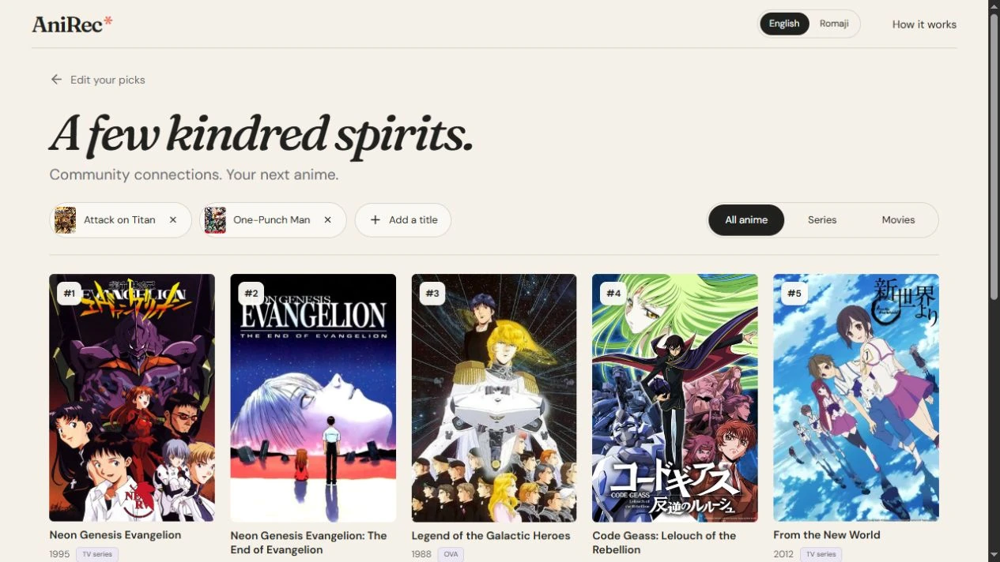

# AniRec

Anime discovery built around shows you already enjoy. Select one to eight anime and explore a balanced set of recommendations drawn from MyAnimeList community connections.

**[Visit AniRec](https://anirec.lukasschulmeyer.com)** · **[Portfolio case study](https://lukasschulmeyer.com/projects/anirec)**



## The experience

- Search MyAnimeList live, with ten more search matches available on request.
- Combine multiple favorites with equal influence for each selected show.
- Browse poster cards and load ten more recommendations until the returned lists are exhausted.
- Open a title for its synopsis, community rating, format, studios, dates, and other available facts.
- Explore linked seasons and parts with individual ratings. Related films are listed separately and keep their own recommendation cards.
- Switch between English and Romaji titles. Share or revisit the selected titles through the results URL.

## What I built

I designed the discovery flow, balanced multi-title ranking, show-grouping rules, and poster-based interface, and integrated the official MyAnimeList API. The application handles missing information, provider errors, bounded caching, and request concurrency. AI coding tools assisted implementation; product decisions and validation remained part of my development process.

**Stack:** React, TypeScript, Vite, Express, Node.js, Radix Dialog, and the MyAnimeList API. The public application is hosted on Vercel.

## Run locally

Requirements: **Node.js 24** and your own MyAnimeList application Client ID.

1. Register an application at [MyAnimeList API configuration](https://myanimelist.net/apiconfig).
2. Copy `.env.example` to `.env` and set `MAL_CLIENT_ID`. Keep this file private. No Client Secret or user OAuth is used.
3. Install and start:

```sh
npm ci
npm run dev
```

Open http://127.0.0.1:4317. If that port is occupied, set `PORT` in `.env`. To serve a production build locally:

```sh
npm run build
npm start
```

Without a configured Client ID, the interface opens and reports unavailable search. It does not substitute fabricated recommendations.

## How recommendations work

Each release's community recommendation counts are divided by the largest count in its original returned list. Linked seasons are grouped into shows, retaining the strongest normalized connection between each source show and candidate show. For each candidate, AniRec combines support across all unique selected shows:

```text
score = (mean(sqrt(normalized support)))²
```

This gives every selected show equal weight and rewards shared support. For example, support of `[0.4, 0.4]` scores `0.4`, while `[1, 0]` scores `0.25`. Selecting two seasons of the same show counts once. MAL ratings and popularity do not determine recommendation order.

Results use only the community connections returned by MAL. The score is relative support, not a probability of enjoyment. The app has no trained model or measured recommendation-accuracy claim. See [architecture and limitations](docs/ARCHITECTURE.md).

## Verification

```sh
npm run check
npm test
npm run deploy:prepare
```

Tests use synthetic upstream responses and require no credentials. They exercise API validation and failure handling, normalization, multi-title balance, deterministic ordering, show identity, film separation, pagination, metadata caching, and rendered component content. GitHub Actions runs these checks. Runtime and visual checks remain separate from these automated tests.

## Deploy

`npm run deploy:prepare` creates a self-contained Vercel package under `deployment/<timestamp>`. It includes the built frontend and bundled API without local credentials or account-specific project settings. Configure `MAL_CLIENT_ID` privately in your Vercel project and deploy that generated directory. See [deployment instructions](docs/DEPLOYMENT.md).

## Sources and rights

This is an independent, noncommercial project. MyAnimeList supplies anime metadata and community recommendation counts; posters belong to their respective rights holders. AniRec is not affiliated with or endorsed by MyAnimeList. This repository contains application code and synthetic tests, not a redistributed anime catalog. See [attribution](docs/ATTRIBUTION.md).

No license is granted for the original application code in this repository. Third-party components retain their own licenses.
